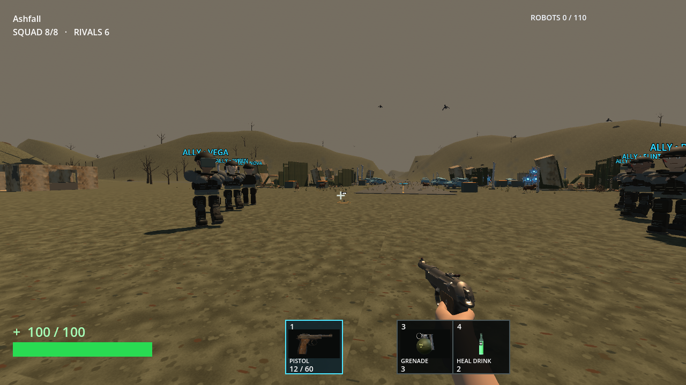
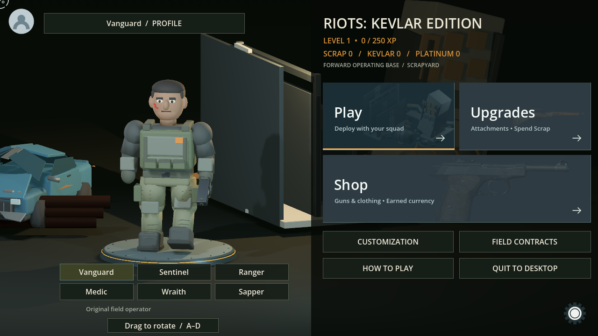
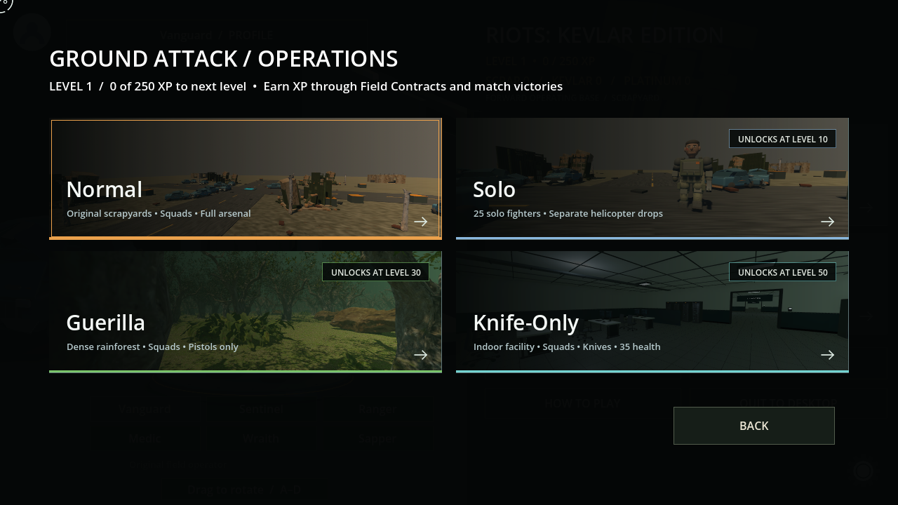
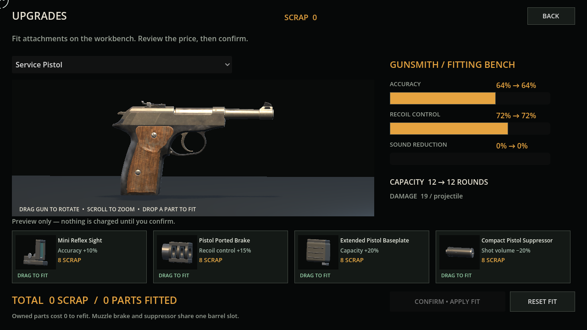
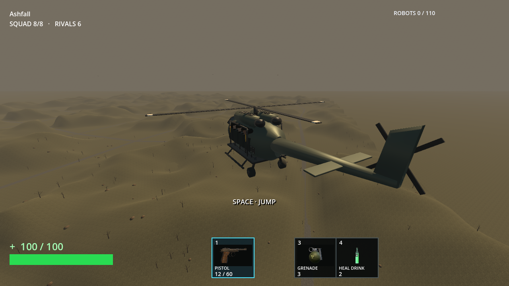

# Riots: Kevlar Edition

An independent, offline squad shooter for Linux. Deploy by helicopter, scavenge equipment, fight robot packs and rival AI squads, and explore a ruined landscape of scrapyards and mountains.



## Download

Linux x86_64 builds are distributed on the [Releases page](https://github.com/SirKatana/riots-kevlar/releases). This repository contains release information and credits, not the game's source code.

### Flatpak

Download `riots-kevlar-0.9.11-x86_64.flatpak` from Releases, then:

```sh
flatpak install --user ./riots-kevlar-0.9.11-x86_64.flatpak
flatpak run io.github.sirkatana.riots-kevlar
```

This is a standalone Flatpak bundle, **not a Flathub listing**. The installer uses the Freedesktop runtime from Flathub. Install Flatpak using your Linux distribution's package manager first.

### Snap

Download `riots-kevlar_0.9.11_amd64.snap` from Releases, then:

```sh
sudo snap install --dangerous ./riots-kevlar_0.9.11_amd64.snap
riots-kevlar
```

This is a locally built, unsigned Snap; `--dangerous` is Snap's option for installing it without a store signature. It still uses strict confinement. Snap Store publication is pending publisher sign-in and review. **`snap install riots-kevlar` is not yet advertised as a store installation command.**

### Portable Linux build

Extract the Linux ZIP and run `./riots-kevlar`. If your archive tool removes executable permissions, run `chmod +x riots-kevlar Riots-Kevlar-Edition.x86_64` first. Requires a graphical Linux desktop and graphics drivers.

## Play

Create a local profile with Riot Sign-In, select Play, and start Normal operations. Keyboard and mouse are required. Open **How to Play** on the main menu for controls and mechanics.

- Unlock Solo at level 10, Guerilla at level 30, and Knife-Only at level 50.
- Complete field contracts and win matches to earn Scrap, Kevlar and Platinum.
- Buy weapons and clothing; fit weapon attachments at the workbench.
- Fight alongside AI squadmates. There is no online multiplayer.
- No real-money purchases or cloud account are required.

The game is in development. Default graphics use Vulkan; compatibility rendering can be selected with `--rendering-method gl_compatibility`. Tested on an NVIDIA GTX 1650; performance varies with hardware.

## Saves and privacy

Profiles and progress are stored locally, not uploaded to a game server. A profile code opens an existing local profile; it is **not a cloud backup**. Packages use separate save folders, so installing a different package format does not automatically migrate progress.

Flatpak saves are under:

```text
~/.var/app/io.github.sirkatana.riots-kevlar/data/godot/app_userdata/Riots- Kevlar Edition/
```

Snap saves are under `~/snap/riots-kevlar/common/data/godot/app_userdata/`. Back up the full game profile folder while the game is closed. Keep these files private.

For Snap save snapshots, close the game and run:

```sh
sudo snap save riots-kevlar
snap saved
```

To restore a backup, close the game and run `sudo snap restore SNAPSHOT_ID riots-kevlar`, replacing `SNAPSHOT_ID` with the ID shown by `snap saved`. Restoring replaces current progress with that backup.

## Screenshots






These are actual captures of the normal game. The admin build is not included in this distribution.

## Credits and support

See [asset and engine notices](licenses/) and [listing details](STORE_LISTING.md). Substantial portions of the code, packaging, documentation and original assets were developed with AI assistance. Other assets are licensed third-party models, textures and recordings.

The game contains fictional weapon combat, blood and death reactions. It is not affiliated with Riot Games, Epic Games, Activision, or the creators of third-party assets.

Report problems through [GitHub Issues](https://github.com/SirKatana/riots-kevlar/issues). Do not attach your profile code or private save files to public issues.
